<div align="center">


<sub>`◢ MARK XLII · SUIT SYSTEMS ONLINE ◣`</sub>

<br/>

### ◢ [**naramcharan.me**](https://naramcharan.me) ◣

<sub>`THE FULL HUD PORTFOLIO — 3D SCROLL-ASSEMBLED, LIVE PROJECT BRIEFS, INTERACTIVE ML TAXONOMY`</sub>

<a href="https://naramcharan.me"></a>

<br/>

<a href="https://naramcharan.me"></a>
<a href="https://rsna-app.salmonmeadow-7644e67e.eastasia.azurecontainerapps.io"></a>

<a href="https://www.linkedin.com/in/naramcharan/"></a>
<a href="mailto:charannaram1710@gmail.com"></a>
<a href="https://wa.me/919966214989"></a>


<br/>

**`B.TECH CSE · AI & ML`**&nbsp;·&nbsp;**`GD GOENKA UNIVERSITY`**&nbsp;·&nbsp;**`YEAR 03`**&nbsp;·&nbsp;**`CGPA 8.98 / 10`**

`◢ OPEN TO INTERNSHIPS`&nbsp;&nbsp;·&nbsp;&nbsp;`GURUGRAM, INDIA`

</div>

---

## `00` ◢ CORE

Third-year CS student specializing in **AI & Machine Learning**, building systems that reach
production rather than stopping at a metric in a notebook — recommendation architectures on learned
embeddings, gradient-boosted forecasters across thousands of parallel series, CNNs on medical
imaging, the serving layer around them — and a GPT plus its tokenizer, written from scratch.

> It started with a man in a suit of armor — but the part that stuck was never the armor.
> It was **JARVIS**. The suit is hardware; the intelligence behind it is the interesting problem.
> That is the whole reason I build what I build.

Three things I care about more than model choice:

- **Leakage-free validation.** Split before you engineer features, split on the entity and not the
  row, and touch the test set once. Every number below comes from a split built that way.
- **Metrics that describe behaviour.** Accuracy on imbalanced data is the number most likely to lie
  to you. Where it would mislead, the honest metric is the one reported.
- **Working with coding agents.** This site was built by directing **Claude Code** — architecture,
  design system and product decisions mine, every change reviewed before it merged. The
  certification below is the theory; [naramcharan.me](https://naramcharan.me) is the artifact.

---

## `01` ◢ TECH STACK

<div align="center">


</div>

<table>
<tr><td valign="top" width="50%">

**`◢ NEURAL` — Deep Learning**


`Transfer Learning` — ResNet · DenseNet · EfficientNet
`CNNs` · `Neural Collaborative Filtering`
`Transformers` · `BPE Tokenizer` — built from scratch
`Vector Embeddings` · `FAISS` similarity search
`Prompt Engineering`

</td><td valign="top" width="50%">

**`◢ MODELS` — Classical ML**


`Random Forest` · `Logistic Regression`
`Hyperparameter Optimization` · `Stratified K-Fold CV`

</td></tr>
<tr><td valign="top" width="50%">

**`◢ SIGNALS` — Data Intelligence**


`Feature Engineering` · `KNNImputer`
`RobustScaler` · `Class Imbalance Handling`
`Recursive Walk-Forward Validation`

</td><td valign="top" width="50%">

**`◢ CORE` — Engineering & Deploy**


`Advanced OOP` · `Data Structures` · `REST APIs`
`SQL · Schema Design` · `SQLAlchemy` · `SQLite` · `PostgreSQL`
`Claude Code · agentic development`
`BeautifulSoup` · `Git` · `Jupyter` · `Kaggle GPU`

</td></tr>
</table>

---

## `02` ◢ SERVICE RECORD

> `◈` **MK-06** is the newest build, still being extended. `◈` **MK-05** is deployed and answering requests. `◈` **MK-04** is the featured build.
> Every metric is from a held-out split, never from training.

| | PROJECT | HEADLINE | STACK | |
|:--|:--|:--|:--|:--|
| **`MK-06`** | **[Handbuilt Transformer](https://github.com/NaramCharan/Handbuilt-Transformer)**<br/><sub>NLP · from scratch · in progress</sub> | **1.82 val loss**<br/><sub>~210K-param GPT</sub> | `PyTorch` `Transformers` `BPE Tokenizer` `NLP` | |
| **`MK-05`** | **[RSNA Pneumonia Detection](https://github.com/NaramCharan/RSNA-Pneumonia-Detection)**<br/><sub>Medical Imaging · **deployed** · Aug 1 – Sep 4, 2026</sub> | **83% recall**<br/><sub>0.79 F1 · 86% acc</sub> | `PyTorch` `pydicom` `FastAPI` `React` `Docker` `Azure` | [**LIVE ↗**](https://rsna-app.salmonmeadow-7644e67e.eastasia.azurecontainerapps.io) |
| **`MK-04`** | **[Walmart Weekly Sales Forecasting](https://github.com/NaramCharan/Walmart-Store-Weekly-Sales-Forecasting)**<br/><sub>Time-Series Forecasting</sub> | **95.55% R²**<br/><sub>validation</sub> | `LightGBM` `XGBoost` `Scikit-Learn` `Pandas` | |
| **`MK-03`** | **[E-Commerce Churn Prediction](https://github.com/NaramCharan/ecommerce-customer-churn-prediction)**<br/><sub>Classification</sub> | **98.28% acc**<br/><sub>94.74% F1</sub> | `XGBoost` `PyTorch` `Scikit-Learn` `Optuna` | |
| **`MK-02`** | **[Neural Collaborative Filtering](https://github.com/NaramCharan/Collaborative_Filtering_Recommendation_system)**<br/><sub>Recommender Systems</sub> | **&lt;10ms**<br/><sub>retrieval</sub> | `PyTorch` `FAISS` | |
| **`MK-01`** | **[Book Scraping & DB Pipeline](https://github.com/NaramCharan/Book-webscrapper)**<br/><sub>Data Engineering</sub> | **980+**<br/><sub>in &lt;30 min</sub> | `BeautifulSoup` `SQLAlchemy` `SQLite` `Pandas` | |

<div align="center">
<sub>Full write-ups, interactive briefs and an ML taxonomy mapping every model to its project → <a href="https://naramcharan.me"><b>naramcharan.me</b></a></sub>
</div>

---

<div align="center"></div>

## `03` ◢ MK-05 · THE ONE THAT SHIPPED

Pneumonia screening on chest radiographs — trained, benchmarked, and running on a public URL.

```
DICOM  →  patient-level split  →  transfer learning  →  FastAPI  →  Docker  →  Azure
```

| | |
|:--|:--|
| **Result** | 83% pneumonia recall · 0.75 precision · 0.79 F1 · 86% accuracy on 1,836 held-out studies |
| **Baseline** | 68% — what you score by always answering "no pneumonia" |
| **Why recall** | ~70% of studies are negative. Accuracy rewards a model that finds nothing |
| **Models** | DenseNet-121 vs EfficientNet-B2 vs ResNet-34, two-stage transfer learning, one protocol |
| **Integrity** | Split
