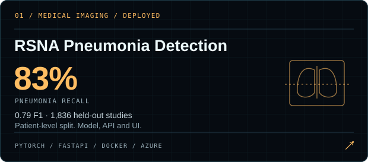
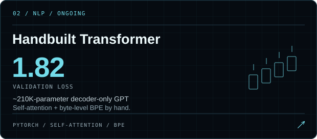
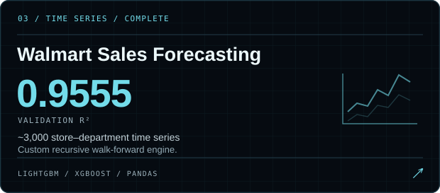
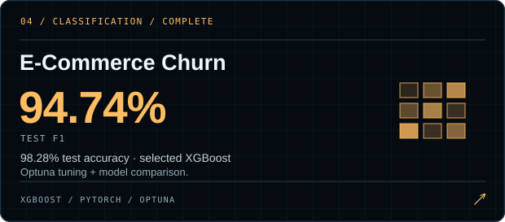
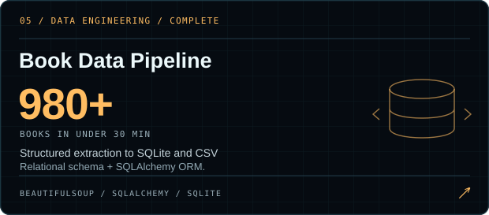
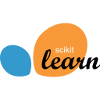
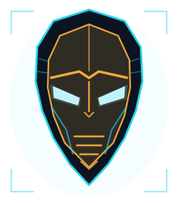

<!-- Upload this README AND the assets/ folder to NaramCharan/NaramCharan. -->

 

<b>3rd-year CS · AI &amp; Machine Learning · Open to internships</b> 
GD Goenka University · Gurugram, India · CGPA 8.98 / 10 · Graduating May 2028

<a href="https://www.linkedin.com/in/naramcharan/">LinkedIn</a> · <a href="mailto:charannaram1710@gmail.com">Email</a> · <a href="https://wa.me/919966214989">WhatsApp</a>

## `01` ◢ SELECTED BUILDS

Medical images, time series, language models, and the systems around them. Open a build to see the code and evaluation.

<table>
<tr>
<td width="50%"></td>
<td width="50%"></td>
</tr>
<tr>
<td width="50%"></td>
<td width="50%"></td>
</tr>
<tr>
<td colspan="2" align="center"></td>
</tr>
</table>

**[Try the deployed X-ray application ↗](https://rsna-app.salmonmeadow-7644e67e.eastasia.azurecontainerapps.io/) · [Read the full project briefs ↗](https://naramcharan.me/#projects)**

## `02` ◢ ENGINEERING PRINCIPLES

- **Check the data reaching the model.** Removing `RandomCrop(224)` from 1024 × 1024 chest X-rays mattered more than switching CNNs.
- **Separate evaluation from tuning.** Patient-level splits for radiographs; chronological evaluation for forecasting. Label validation and test results clearly.
- **Build the serving path.** Matching preprocessing, an API, a usable interface, and a deployment belong in the same project.

## `03` ◢ SYSTEMS I WORK WITH

<table width="100%">
<thead><tr>
<th width="25%" align="left">NEURAL</th>
<th width="25%" align="left">MODELS</th>
<th width="25%" align="left">SIGNALS</th>
<th width="25%" align="left">CORE</th>
</tr></thead>
<tbody><tr>
<td width="25%" valign="top">
&nbsp;PyTorch  &nbsp;CNNs  &nbsp;transfer&nbsp;learning  &nbsp;self-attention  &nbsp;BPE  &nbsp;embeddings
</td>
<td width="25%" valign="top">
&nbsp;Linear&nbsp;Regression  &nbsp;Logistic&nbsp;Regression  &nbsp;Random&nbsp;Forest  &nbsp;XGBoost  &nbsp;LightGBM  &nbsp;K-Means&nbsp;Clustering  &nbsp;Isolation&nbsp;Forest Anomaly detection  &nbsp;scikit-learn  &nbsp;Optuna
</td>
<td width="25%" valign="top">
&nbsp;Pandas  &nbsp;NumPy  &nbsp;pydicom  &nbsp;feature&nbsp;engineering  &nbsp;walk-forward&nbsp;evaluation
</td>
<td width="25%" valign="top">
&nbsp;Python  &nbsp;FastAPI  &nbsp;SQLAlchemy  &nbsp;SQL  &nbsp;SQLite  &nbsp;Docker  &nbsp;Azure  &nbsp;Git  &nbsp;Claude&nbsp;Code
</td>
</tr></tbody>
</table>

## `04` ◢ NEXT BUILD

I'm extending my **handbuilt GPT and BPE tokenizer** while studying transformer internals. My goal is to understand the model, evaluate it clearly, and make it usable.

<b>◢ Origin story</b>

<table width="100%">
<tr>
<td width="180" align="center" valign="middle">

</td>
<td valign="top">

It started with a man in a suit of armor. What stayed with me was the AI he talked to.

I'm a third-year Computer Science student specializing in AI &amp; Machine Learning. I work on medical-image classifiers, forecasting pipelines, and models built from scratch.

My <a href="https://naramcharan.me">portfolio</a> connects those projects through an interactive ML taxonomy and a WebGL armor assembly sequence. I built it with Next.js and WebGL by directing Claude Code.

</td>
</tr>
</table>

<b>◢ Learning record</b>

- [Deep Learning Specialization](https://learn.deeplearning.ai/certificates/07716d58-daf9-4806-80a5-cfdac044a258?usp=sharing)
- [Machine Learning Specialization](https://learn.deeplearning.ai/certificates/d6a3b687-26ba-4937-9e18-abbb3ce46570?usp=sharing)
- [Claude Code: A Highly Agentic Coding Assistant](https://learn.deeplearning.ai/accomplishments/1aa0da77-0c19-49ac-a36f-3652f5d9bab9?usp=sharing)
- [Databases & SQL for Data Science with Python](https://www.coursera.org/account/accomplishments/verify/YY9BFB88ZGTY)
- [Python for Everybody Specialization](https://www.coursera.org/account/accomplishments/specialization/9SMN49FA2C57)
- [Prompt Engineering & Generative AI](https://www.coursera.org/account/accomplishments/verify/G8SCN6OHEXWR)

---

<code>CHANNELS OPEN // LET'S BUILD</code>

<b>Open to ML internships and collaborations.</b> 
<a href="https://naramcharan.me">naramcharan.me</a> · <a href="https://www.linkedin.com/in/naramcharan/">LinkedIn</a> · <a href="mailto:charannaram1710@gmail.com">charannaram1710@gmail.com</a>

